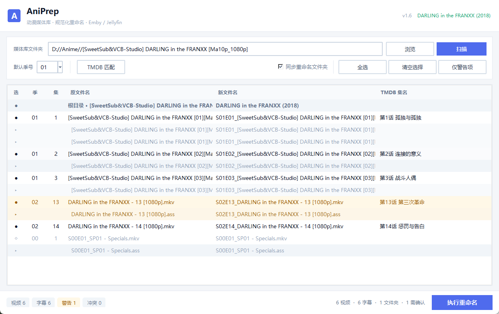

# AniPrep — 动漫媒体库规范化重命名

[](https://www.python.org/)
[](#)
[](LICENSE)

把动漫视频和外挂字幕一键重命名成 **Emby / Jellyfin** 认得的格式，顺带把分季文件夹、跨季集号、字幕同步这些琐事一起处理掉。

```
重命名前：S1/One Piece - 01.mkv
重命名后：S01E01_One Piece - 01.mkv
```



---

## ✨ 核心功能

| 功能 | 说明 |
|------|------|
| **拖放导入** | 把文件夹从资源管理器直接拖进窗口即可扫描；拖的是单个视频文件时，自动往上找到剧集根目录 |
| **智能扫描** | 自动识别 `S1` / `Season 1` / `第1季` 等分季文件夹 |
| **集号提取** | 支持 `[01]`、`EP01`、`第01话`、`SP01`、`- 01` 等 7 种命名格式 |
| **字幕同步** | 自动匹配 `.ass` / `.srt` / `.ssa` / `.sub` / `.vtt` 等字幕并同步重命名，支持 `.sc.ass` / `.tc.ass` 双扩展名 |
| **TMDB 集成** | 自动匹配剧集信息，获取官方集名；标题提取会剥掉 `[压制组]`、`[1080p]`、`[简繁外挂]` 等技术标记 |
| **跨季偏移** | 识别全局顺序编号（S2 从 13 开始）并换算成季内编号；特典季 S00 不参与累计 |
| **文件夹重命名** | 可选同步重命名根目录为 `{剧名} ({年份})`，分季目录为 `Season XX` |
| **冲突与安全检查** | 命名冲突高亮拦截、Windows 路径过长提醒、可疑集号标黄待确认 |
| **高 DPI 适配** | 按物理像素渲染，4K / 150% 缩放屏上文字不发虚 |

---

## 🚀 快速开始

### 方式一：直接运行 EXE（推荐）

下载 `dist/AniPrep.exe`，双击运行，**无需安装 Python**。

### 方式二：源码运行

```bash
git clone https://github.com/fengruoIing/AniPrep.git
cd AniPrep

# 依赖（仅 TMDB 匹配功能需要）
pip install requests

python AniPrep.py
```

> 需要 Python 3.9 及以上（代码里用了 `list[...]` / `dict[...]` 泛型注解）。

---

## 📖 使用流程

```
1. 选择剧集根文件夹
   ├─ 点击「浏览」
   └─ 或直接把文件夹从资源管理器拖进窗口
   ↓
2. 点击「扫描」→ 自动识别分季结构、提取集号、匹配字幕
   ↓
3. （可选）点击「TMDB 匹配」选择对应剧集，获得官方集名与分季数据
   ↓
4. 在表格里审核：
   ├─ 单击「选」列勾选 / 取消
   ├─ 双击「季」或「集」列直接改
   └─ 琥珀色行表示集号可疑，需要确认
   ↓
5. （可选）勾选「同步重命名文件夹」
   ↓
6. 点击「执行重命名」
```

> ⚠️ 重命名不可撤销。第一次用建议先拿个小文件夹试，确认「新文件名」列都符合预期再批量执行。

---

## 🔑 TMDB API Key（可选）

TMDB 功能需要一个**免费**的 API Key：

1. 打开 [themoviedb.org/settings/api](https://www.themoviedb.org/settings/api)
2. 注册账号（免费），申请 API Key（选 Developer）
3. 菜单 **设置 → TMDB API Key 设置…** 填入

> 不填也能用：扫描、集号提取、字幕同步、重命名全部走本地逻辑，只是没有官方集名和分季校验。

---

## 📋 支持的命名格式

### 分季文件夹

| 格式 | 示例 |
|------|------|
| `S{数字}` | `S1`、`S01`、`S0` |
| `Season {数字}` | `Season 1`、`season 01` |
| `第{数字}季` | `第1季`、`第 2 季` |

### 集号提取

按优先级依次尝试，并取文件名中**靠后**的那个数字：

| 格式 | 示例 |
|------|------|
| `[数字]` | `[01]`、`[720]` |
| `第{数字}话` | `第01话`、`第720話` |
| `EP{数字}` | `EP01`、`Ep001` |
| `SP{数字}` | `SP01`、`sp_02`（特典专用） |
| `- {数字}` | `- 01` |
| `.数字.ext` | `.001.mkv` |
| `_{数字}` | `_001` |

### 输出格式

```
S{季号2位}E{集号2-3位}_{原文件名}.{扩展名}

One Piece - 01.mkv   →  S01E01_One Piece - 01.mkv
MyAnime_SP01.mkv     →  S00E01_MyAnime_SP01.mkv
```

### 标题提取（用于 TMDB 搜索）

从文件夹名里剥掉发布组、分辨率编码、字幕标记等技术信息：

```
[SweetSub&VCB-Studio] DARLING in the FRANXX [Ma10p_1080p]
  → DARLING in the FRANXX

[Nekomoe kissaten][Bocchi the Rock!][01-12][1080p][CHS_JPN]
  → Bocchi the Rock!

[Lilith-Raws] 葬送的芙莉莲 / Sousou no Frieren [Baha][WEB-DL][1080p]
  → 葬送的芙莉莲
```

---

## 🗂️ 项目结构

```
AniPrep/
├── AniPrep.py              # 主程序（单文件）
├── aniprep_config.json     # 配置文件（自动生成，已 gitignore）
├── README.md
├── LICENSE
├── docs/
│   └── screenshot.png      # 界面截图
└── dist/
    └── AniPrep.exe         # 打包好的可执行文件
```

---

## ⚙️ 配置文件

`aniprep_config.json` 自动生成在程序同目录（EXE 就在 exe 旁边）：

```json
{
  "tmdb_api_key": "",
  "tmdb_language": "zh-CN",
  "last_root_folder": "",
  "rename_folders": false,
  "window_geometry": "1240x780+100+50",
  "ui_scale": 1.0
}
```

`ui_scale` 记录保存窗口尺寸时的界面缩放比 —— 换到不同 DPI 的显示器后，窗口会按比例还原，而不是突然变小或变大。

---

## 🔧 从源码打包

```bash
pip install pyinstaller requests
pyinstaller AniPrep.spec      # 或 pyinstaller --onefile --windowed --name AniPrep AniPrep.py
# 输出：dist/AniPrep.exe，约 14 MB
```

两个容易踩的点：

- **`requests` 必须装在打包用的 Python 里**。只装 PyInstaller 而漏了 requests，打出来的 exe 会启动即闪退（`ModuleNotFoundError: No module named 'requests'`）。
- 装了 UPX 后 spec 里的 `upx=True` 会自动生效，体积能压到 6 MB 左右。

---

## 🐛 常见问题

| 问题 | 解决方法 |
|------|----------|
| 拖文件夹进来没反应 | 确认没有正在扫描或重命名（这两个阶段会忽略拖放）；拖到窗口任意位置都行，不用瞄准表格 |
| 字幕文件没被识别 | 字幕要和视频**同目录**且**主文件名一致**；支持 `.sc.ass` 这类双扩展名 |
| SP 特典集号全是 S00E00 | 文件名里要有 `SP01` / `sp_02` 这类明确标记 |
| 第二季集号从 13 开始 | 启用 TMDB 后会自动偏移；也可以双击「集」列手动改 |
| TMDB 搜不到 | 先看搜索框预填的剧名对不对，手动改成中文或日文原名通常就能搜到 |
| 4K 屏上界面很小 | 程序已适配高 DPI；若仍偏小，调大 Windows 缩放比例即可，界面会跟着放大 |
| 重命名后 Emby 没识别 | 检查目录结构是否为 `根/剧名 (年份)/Season 01/S01E01_xxx.mkv` |

---

## 📄 License

[MIT](LICENSE) © 2025 fengruoIing

---

## 🙏 致谢

- [The Movie Database (TMDB)](https://www.themoviedb.org/) — 提供免费 API
- [Emby](https://emby.media/) / [Jellyfin](https://jellyfin.org/) — 命名规范参考
